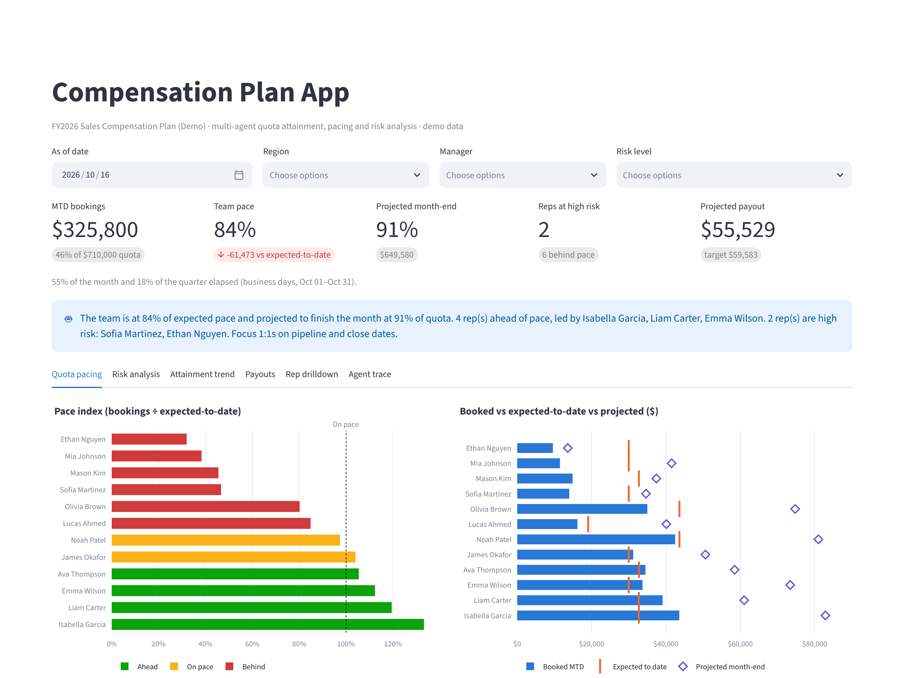
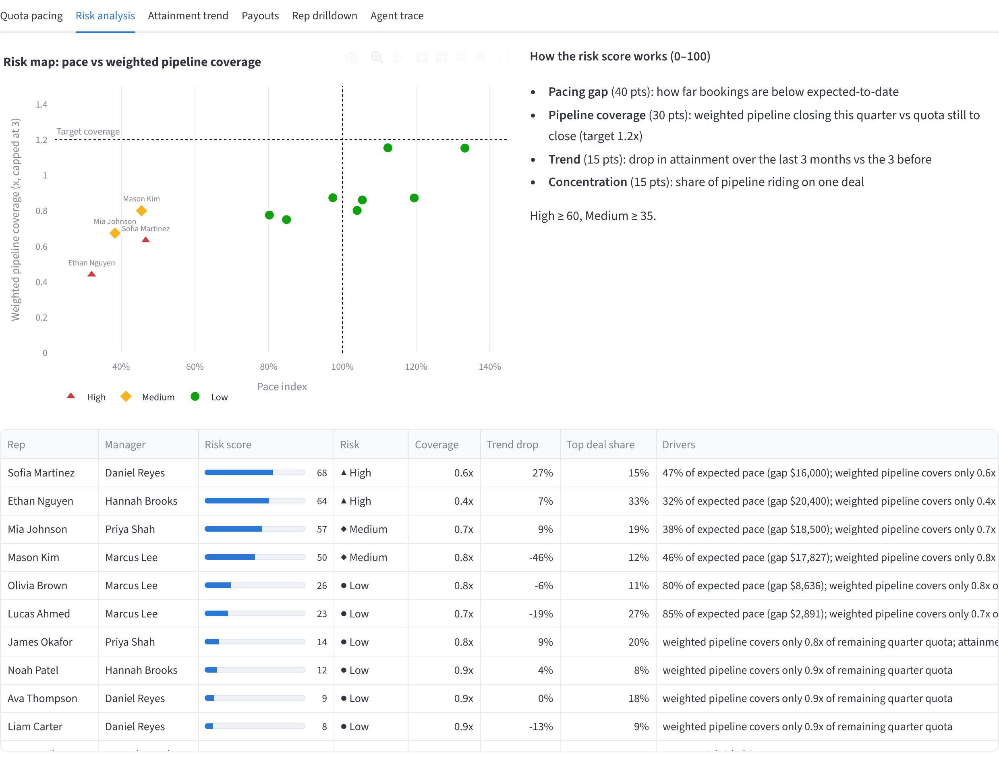
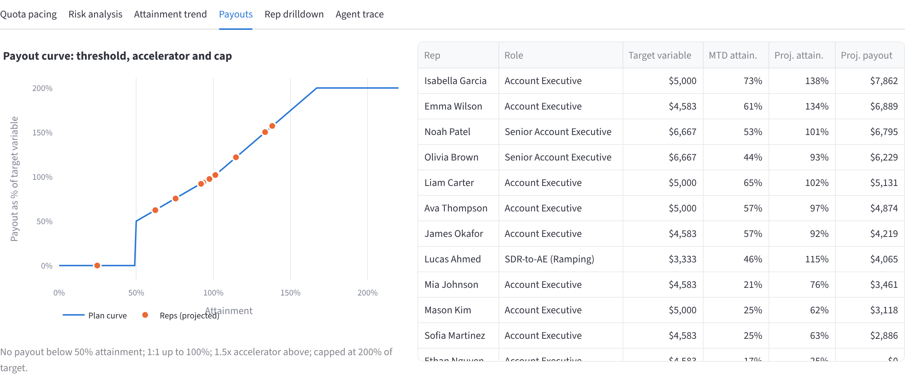

# Compensation Plan App

A multi-agent analytics app that tracks **monthly quota attainment, quota pacing, risk of missing quota, and projected commission** for a sales team, shown in an interactive Streamlit dashboard.

> All reps, accounts and numbers are **synthetic demo data** created by `data/generate_demo_data.py`.



## What it does

| Question a sales leader asks | How the app answers it |
|---|---|
| How much has each rep booked against quota? | MTD, QTD and YTD attainment per rep |
| Are reps on track *today*, not just at month-end? | **Quota pacing:** bookings ÷ expected-to-date (business-day pro-rated), with Ahead / On pace / Behind status |
| Where will we land? | Projected month-end and quarter-end attainment (run rate blended with weighted pipeline) |
| Who is at risk of missing quota, and why? | **Risk score (0–100)** with plain-language drivers |
| What will we pay out? | Commission estimate from the plan curve (threshold, accelerator, cap) |

## Multi-agent architecture

Each agent has one job. They share a context object, and the orchestrator runs them in order and records a trace that you can view in the app.

```
CRM exports (reps, quotas, deals)
        │
        ▼
 ┌──────────────┐   ┌──────────────────┐   ┌──────────────┐   ┌────────────┐   ┌──────────────┐   ┌────────────────┐
 │  Data Agent  │──▶│ Attainment Agent │──▶│ Pacing Agent │──▶│ Risk Agent │──▶│ Payout Agent │──▶│ Insights Agent │
 └──────────────┘   └──────────────────┘   └──────────────┘   └────────────┘   └──────────────┘   └────────────────┘
  load + validate    MTD/QTD/YTD vs quota   expected-to-date,   0–100 score +     plan curve →       coaching notes +
  (dupes, bad rows,                         pace index,         drivers           projected payout   team summary
  orphan deals)                             projections                                              (rules or Claude)
```

| Agent | File | Output |
|---|---|---|
| Data Agent | `agents/data_agent.py` | Clean reps, quotas, deals + a list of data issues |
| Attainment Agent | `agents/attainment_agent.py` | Bookings and attainment by month, MTD, QTD, YTD |
| Pacing Agent | `agents/pacing_agent.py` | Expected-to-date, pace index, gap to pace, projected month/quarter |
| Risk Agent | `agents/risk_agent.py` | Risk score, level and drivers per rep |
| Payout Agent | `agents/payout_agent.py` | Projected commission per rep |
| Insights Agent | `agents/insights_agent.py` | Coaching note per rep and a team summary |
| Orchestrator | `agents/orchestrator.py` | Runs the agents and keeps the trace |

## Calculations

**Pacing**
- `expected_to_date = month_quota × (business days elapsed ÷ business days in month)`
- `pace_index = MTD bookings ÷ expected_to_date`. Ahead ≥ 105%, On pace ≥ 95%, otherwise Behind.
- `projected_month = average(run-rate projection, booked + weighted pipeline closing this month)`

**Risk score (0–100)**

| Driver | Weight | Measures |
|---|---|---|
| Pacing gap | 40 | How far bookings are below expected-to-date |
| Pipeline coverage | 30 | Weighted pipeline closing this quarter ÷ quota still to close (target 1.2x) |
| Trend | 15 | Drop in attainment over the last 3 months vs the 3 before |
| Concentration | 15 | Share of pipeline riding on a single deal |

High ≥ 60, Medium ≥ 35, Low otherwise.

**Payout curve:** no payout below 50% attainment, 1:1 from 50% to 100%, 1.5x accelerator above 100%, capped at 200% of target variable.

Every threshold and weight lives in [`comp_plan.json`](comp_plan.json), so you can change the plan without touching code.



## Run it

```bash
git clone https://github.com/afzalbeena16/Comp-Plan-App.git
cd comp-plan-app
python -m venv .venv && source .venv/bin/activate   # Windows: .venv\Scripts\activate
pip install -r requirements.txt

streamlit run app.py          # dashboard at http://localhost:8501
python run_pipeline.py        # same pipeline in the terminal
pytest -q                     # tests
```

Optional: set `ANTHROPIC_API_KEY` and `pip install anthropic` to have the Insights Agent write the team summary with Claude. Without a key it uses rule-based text, so the demo works offline.

## Dashboard tabs

- **Quota pacing**: pace index per rep, booked vs expected vs projected, and a full pacing table
- **Risk analysis**: risk map (pace vs pipeline coverage), scoring method, and drivers per rep
- **Attainment trend**: monthly attained goal for any rep vs the team, plus a heatmap
- **Payouts**: plan curve with each rep plotted, and projected commission
- **Rep drilldown**: one rep's status, coaching note, risk drivers, and open pipeline
- **Agent trace**: what each agent did, how long it took, and any data issues

Filters (as-of date, region, manager, risk level) apply to every tab.



## Project structure

```
comp-plan-app/
├── app.py                  # Streamlit dashboard
├── run_pipeline.py         # CLI runner
├── comp_plan.json          # plan rules: thresholds, weights, payout curve
├── agents/                 # one module per agent + orchestrator
├── data/                   # demo CSVs + generator script
├── tests/                  # pytest suite
└── docs/                   # screenshots
```

## Using your own data

Replace the three CSVs in `data/` with exports from Salesforce (or any CRM) using the same columns:

- `reps.csv`: rep_id, rep_name, role, region, manager, annual_variable_ote
- `quotas.csv`: rep_id, year, month, quota
- `deals.csv`: deal_id, rep_id, account, amount, stage, probability, created_date, close_date

## Tech

Python · pandas · NumPy · Streamlit · Plotly · pytest · optional Claude API

## Author

**Beena Afzal**, Senior Data Analyst ([LinkedIn](https://linkedin.com/in/beena-afzal-b0906a383))

## License

MIT
